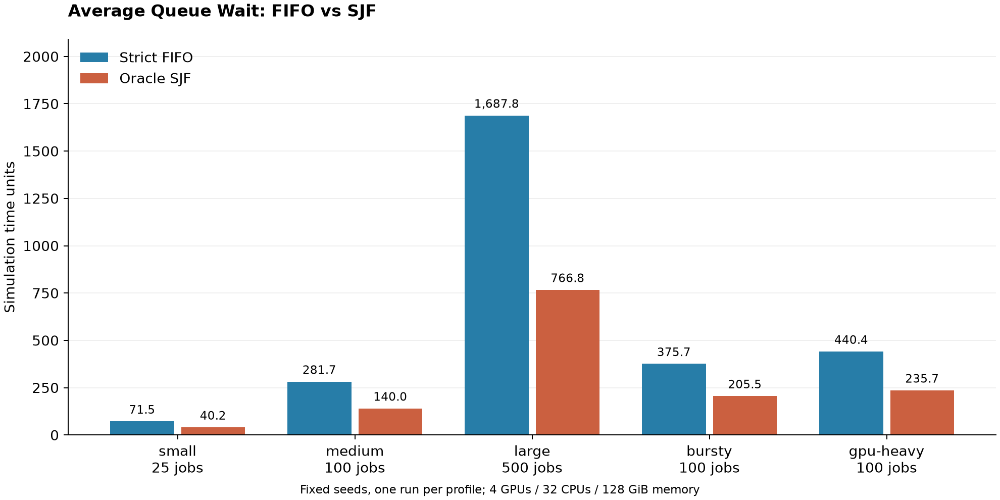
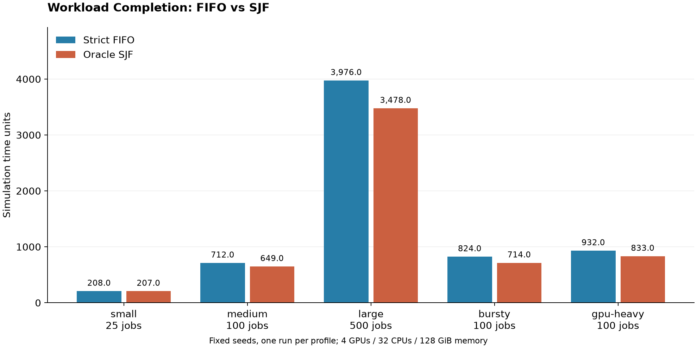

# Helios

Helios is a C++/Python project for studying GPU cluster job scheduling with classical
baselines and, later, reinforcement learning.

The C++ simulator compares strict FIFO and non-preemptive shortest-job-first (SJF)
scheduling on named demos and seeded synthetic workloads. It exports per-job metrics
and benchmark summaries as CSV, with Python scripts for plotting the results.

## Current Status

- Milestone 1 scaffold is complete.
- Phase 2 added C++ job/resource model primitives.
- Phase 3 added runtime job state, events, simulator state, and explicit lifecycle transitions.
- Phase 4 added scheduler decisions and a strict FIFO scheduler.
- Phase 5 added workload/metrics types, a FIFO simulation runner, CSV output, and named demo workloads.
- Phase 6 added a shared simulation runner, oracle SJF, and FIFO/SJF comparison.
- Phase 7 now includes seeded generation, five standard profiles, suite summaries,
  and reproducible benchmark charts.
- Python bindings, Gymnasium, and RL training are future work.

## Current Capabilities

- Validate jobs, resources, workloads, and simulator state.
- Allocate and release GPU/CPU/memory resources.
- Move jobs through pending, running, and completed states.
- Run strict FIFO and non-preemptive oracle SJF through the same simulation runner.
- Generate repeatable workloads and compare five profiles with 25 to 500 jobs each.
- Compute per-job metrics:
  - arrival time
  - start time
  - completion time
  - duration
  - wait time
  - turnaround time
- Print benchmark results as CSV.

## Planned Stack

- C++20, CMake, Ninja
- CTest for initial smoke tests; GoogleTest or Catch2 for simulator unit tests later
- Python 3.11+, pybind11, Gymnasium, PyTorch, Stable-Baselines3
- GitHub Actions CI

## Build

```bash
cmake -S . -B build -G Ninja
cmake --build build
ctest --test-dir build --output-on-failure
```

Run the CLI:

```bash
./build/helios_sim
```

On Windows PowerShell, the executable is usually:

```powershell
.\build\helios_sim.exe
```

List built-in demo workloads:

```bash
./build/helios_sim --list-demo-workloads
```

Run a FIFO demo workload and print CSV:

```bash
./build/helios_sim --demo-fifo light-overlap
./build/helios_sim --demo-fifo fifo-blocking
./build/helios_sim --demo-fifo staggered-arrivals
./build/helios_sim --demo-fifo gpu-contention
```

Save output to a CSV file:

```bash
./build/helios_sim --demo-fifo fifo-blocking > benchmarks/fifo_blocking.csv
```

Generated workload profiles use fixed seeds on the demo cluster (4 GPUs, 32 CPUs,
131072 MB memory):

| Profile | Jobs | Seed | Arrival range | GPUs per job |
| --- | ---: | ---: | --- | --- |
| `generated-small` | 25 | 701 | 0-50 | 1-4 |
| `generated-medium` | 100 | 702 | 0-100 | 1-4 |
| `generated-large` | 500 | 703 | 0-500 | 1-4 |
| `generated-bursty` | 100 | 704 | 0-3 | 1-4 |
| `generated-gpu-heavy` | 100 | 705 | 0-100 | 2-4 |

All ranges are inclusive. Durations range from 1 to 20 simulation time units;
CPU requests range from 2 to 16 and memory requests from 4096 to 32768 MB.
Bursty models one concentrated arrival burst. Fields are sampled independently.
Repeated calls with the same build and standard library produce the same jobs;
exact random samples are not guaranteed across standard library implementations.

Compare FIFO and non-preemptive oracle SJF on the same generated workload, or
inspect SJF's per-job CSV:

```bash
./build/helios_sim --compare generated-medium
./build/helios_sim --compare generated-large
./build/helios_sim --demo-sjf generated-bursty
```

SJF uses known simulated job durations. These synthetic profiles exercise the
simulator; they do not establish that one scheduler wins on real cluster workloads.

CSV columns:

```text
job_id,arrival_time,start_time,completion_time,duration,wait_time,turnaround_time
```

## FIFO vs SJF Benchmarks

The suite runs both schedulers on identical inputs for each profile, using the
cluster and fixed seeds listed above. Each scheduler completes 825 jobs across
the five profiles. Run the suite and save the summary CSV:

```bash
./build/helios_sim --compare-suite > benchmarks/generated_suite.csv
```

Results from the checked-in [summary CSV](benchmarks/generated_suite.csv):

| Profile | Jobs per scheduler | FIFO average wait | SJF average wait | FIFO makespan | SJF makespan |
| --- | ---: | ---: | ---: | ---: | ---: |
| Small | 25 | 71.52 | 40.20 | 208 | 207 |
| Medium | 100 | 281.68 | 140.00 | 712 | 649 |
| Large | 500 | 1687.85 | 766.77 | 3976 | 3478 |
| Bursty | 100 | 375.67 | 205.46 | 824 | 714 |
| GPU-heavy | 100 | 440.44 | 235.65 | 932 | 833 |

Wait time is `start_time - arrival_time`; average wait is the sum of all job waits
divided by completed job count. Makespan is the last completion time measured
from simulation time zero, including initial idle time. All times use abstract
simulation units, not wall-clock execution seconds. Lower is better for both.





SJF reduced average wait in all five samples. On the 500-job profile, average wait
fell from 1687.85 to 766.77 and makespan fell from 3976 to 3478. These are one seed
per profile, with no confidence intervals or claim of statistical significance.
Profiles differ in size and arrival patterns; compare policies within a profile.
SJF knows true runtimes and skips jobs that cannot currently fit; strict FIFO
waits behind its blocked head job. Both run jobs to completion without preemption.
These differences can favor short jobs and increase individual long-job waits,
even when the average improves.

Regenerate the charts from the CSV (Python handles plotting only):

```bash
python3 -m venv .venv
.venv/bin/python -m pip install -r scripts/requirements-plots.txt
.venv/bin/python scripts/plot_benchmarks.py benchmarks/generated_suite.csv
```

The script writes PNG images for the README and SVG versions for export under
`docs/images/`. No simulation is performed by the plotting script.

## Format

```powershell
.\scripts\format.ps1
```

or:

```bash
./scripts/format.sh
```

## Project Structure

```text
apps/helios_sim/   Command-line simulator executable
include/helios/    Public C++ headers
src/               C++ implementation
tests/cpp/         C++ tests
python/helios/     Future Python package
tests/python/      Future pytest suite
benchmarks/        Saved benchmark CSV outputs
configs/           Future experiment and workload configs
docs/              Design notes and metric definitions
scripts/           Formatting and benchmark plotting scripts
```

## Current Limitations

- Synthetic profiles use independent bounded integer sampling rather than real traces.
- Job durations are known simulated runtimes; SJF is an oracle baseline.
- Current benchmark snapshots use one fixed seed per profile.
- Exact generated samples can differ between C++ standard library implementations.
- No Python bindings, Gymnasium environment, PPO training, or dashboards yet.

## Development Workflow

Use one branch per issue, open pull requests into `main`, and keep every change small
enough to review. Simulator features should include tests before they are merged.
