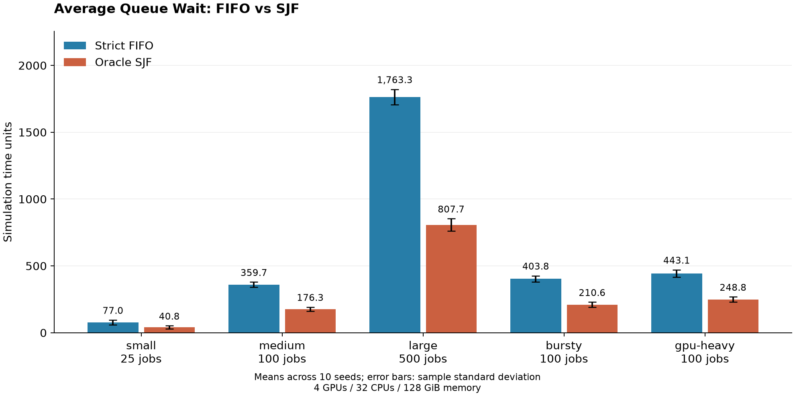
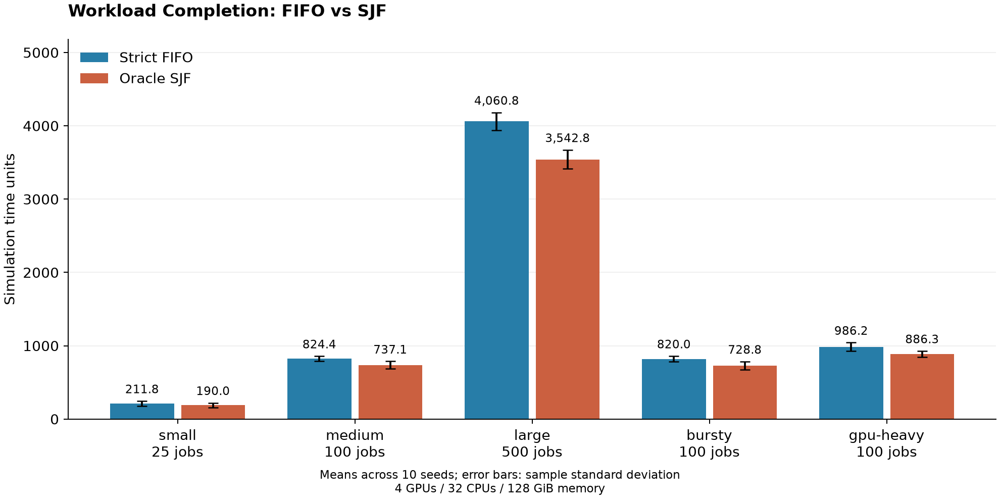
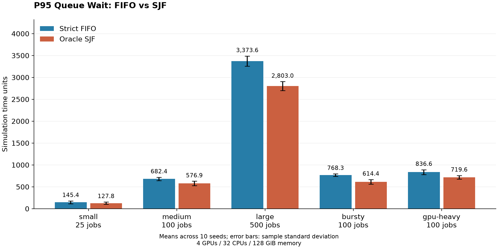
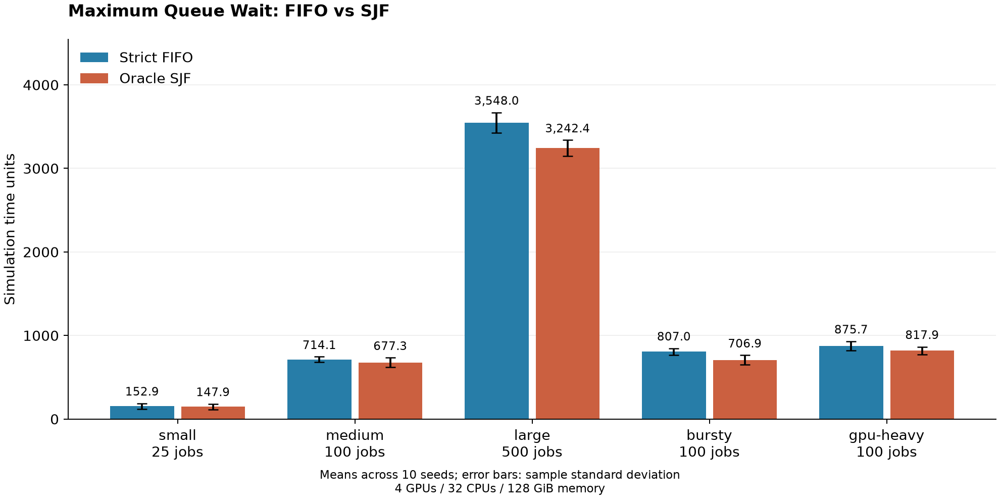
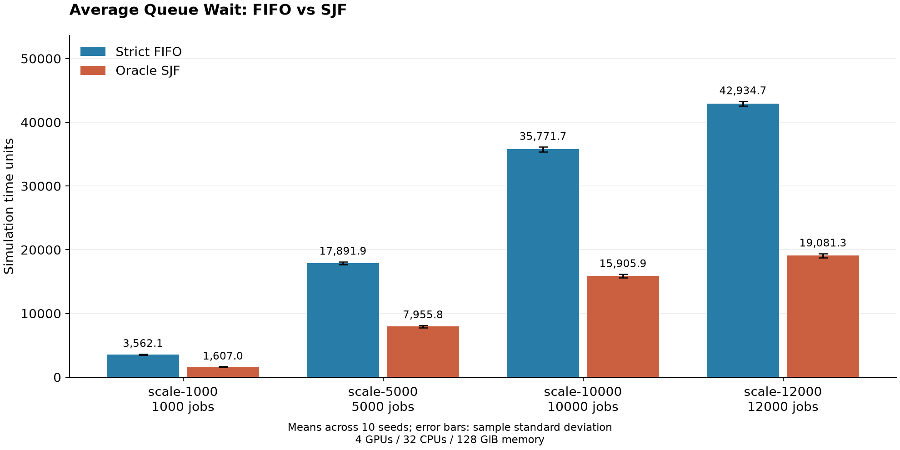
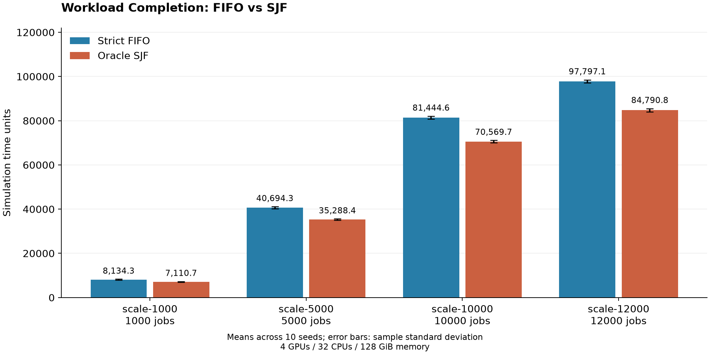
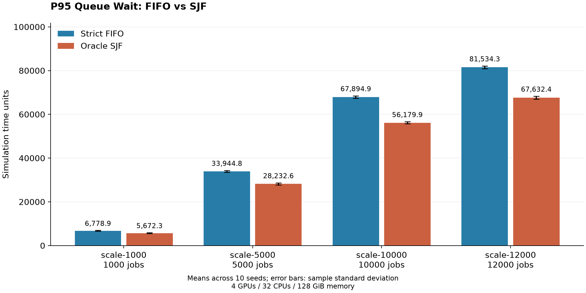
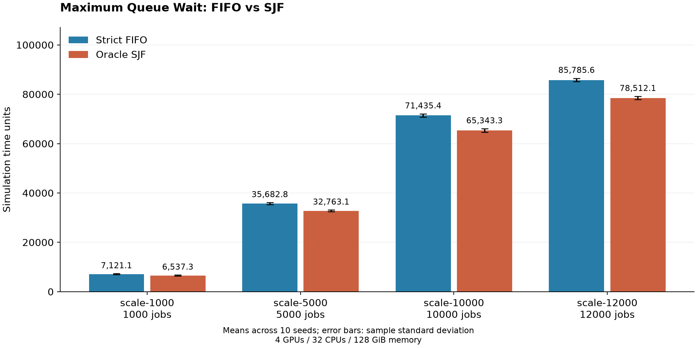
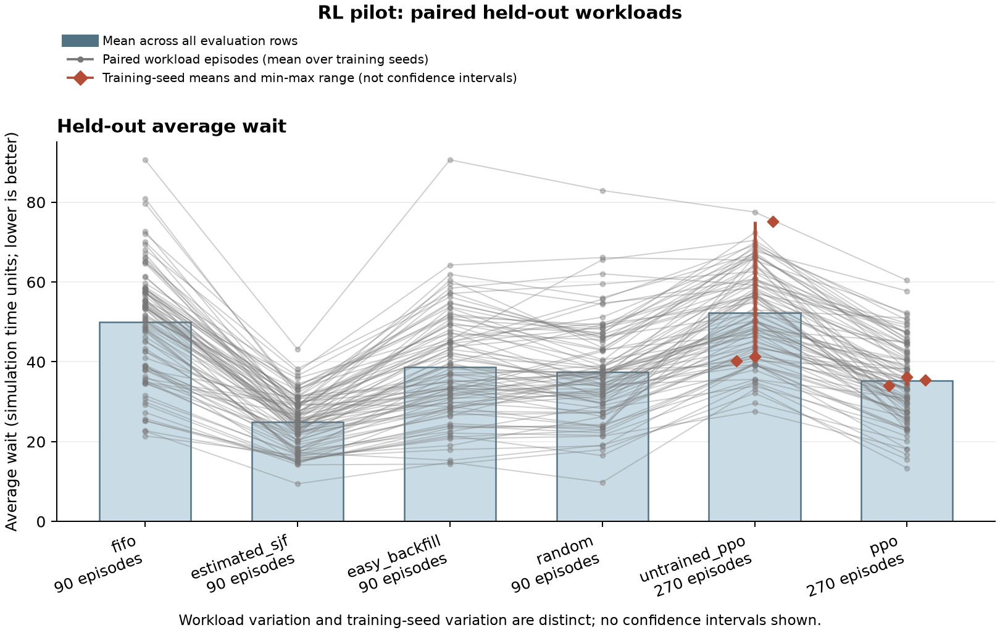
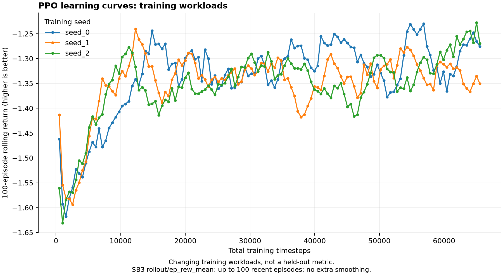

# Helios

Helios is a C++/Python project for studying GPU cluster job scheduling with classical
baselines and reinforcement learning.

The C++ simulator compares FIFO, oracle and estimated shortest-job-first (SJF),
seeded random scheduling, and EASY-style backfilling. It supports both batch runs
and an interactive decision API over named demos and seeded synthetic workloads.
It exports metrics as CSV, with Python scripts for plotting the results.

## Current Status

- Milestone 1 scaffold is complete.
- Phase 2 added C++ job/resource model primitives.
- Phase 3 added runtime job state, events, simulator state, and explicit lifecycle transitions.
- Phase 4 added scheduler decisions and a strict FIFO scheduler.
- Phase 5 added workload/metrics types, a FIFO simulation runner, CSV output, and named demo workloads.
- Phase 6 added a shared simulation runner, oracle SJF, and FIFO/SJF comparison.
- Phase 7 includes seeded generation, paired comparisons across multiple seeds,
  scale workloads up to 12,000 jobs, and reproducible benchmark charts.
- Milestone 8 adds a managed runtime that updates private state in place.
- Milestone 9 separates optional runtime estimates from actual execution durations.
- Milestone 10 adds seeded random and estimated EASY-style backfilling baselines.
- Milestone 11 adds `Simulator::reset`, `observe`, `step`, `done`, and terminal results.
- Phase 11 exposes the interactive C++ simulator to Python. A first Gymnasium
  environment wraps that API.
- Phase 12 adds seeded training episodes, masked PPO, checkpoint replay, and
  paired held-out evaluation. See the [pilot plan](docs/Phase12.md).

## Current Capabilities

- Validate jobs, resources, workloads, and simulator state.
- Allocate and release GPU/CPU/memory resources.
- Move jobs through pending, running, and completed states.
- Run strict FIFO and non-preemptive oracle SJF through the same simulation runner.
- Drive the same C++ engine one decision at a time using observations without future jobs.
- Supply per-job runtime estimates and test scheduling under estimate errors.
- Generate repeatable workloads from 25 to 12,000 jobs and compare multiple seeds.
- Report average, P95, and maximum queue wait for each scheduler run.
- Compute per-job metrics:
  - arrival time
  - start time
  - completion time
  - duration
  - wait time
  - turnaround time
- Print benchmark results as CSV.

## Planned Stack

- C++20, CMake, Ninja
- CTest for initial smoke tests; GoogleTest or Catch2 for simulator unit tests later
- Python 3.11+, pybind11, Gymnasium, PyTorch, Stable-Baselines3
- GitHub Actions CI

## Build

```bash
cmake -S . -B build -G Ninja
cmake --build build
ctest --test-dir build --output-on-failure
```

Run the CLI:

```bash
./build/helios_sim
```

On Windows PowerShell, the executable is usually:

```powershell
.\build\helios_sim.exe
```

List built-in demo workloads:

```bash
./build/helios_sim --list-demo-workloads
```

Run a FIFO demo workload and print CSV:

```bash
./build/helios_sim --demo-fifo light-overlap
./build/helios_sim --demo-fifo fifo-blocking
./build/helios_sim --demo-fifo staggered-arrivals
./build/helios_sim --demo-fifo gpu-contention
```

Save output to a CSV file:

```bash
./build/helios_sim --demo-fifo fifo-blocking > benchmarks/fifo_blocking.csv
```

Generated workload profiles use fixed seeds on the demo cluster (4 GPUs, 32 CPUs,
131072 MB memory):

| Profile | Jobs | Seed | Arrival range | GPUs per job |
| --- | ---: | ---: | --- | --- |
| `generated-small` | 25 | 701 | 0-50 | 1-4 |
| `generated-medium` | 100 | 702 | 0-100 | 1-4 |
| `generated-large` | 500 | 703 | 0-500 | 1-4 |
| `generated-bursty` | 100 | 704 | 0-3 | 1-4 |
| `generated-gpu-heavy` | 100 | 705 | 0-100 | 2-4 |

All ranges are inclusive. Durations range from 1 to 20 simulation time units;
CPU requests range from 2 to 16 and memory requests from 4096 to 32768 MB.
Bursty models one concentrated arrival burst. Fields are sampled independently.
Repeated calls with the same build and standard library produce the same jobs;
exact random samples are not guaranteed across standard library implementations.

Compare FIFO and non-preemptive oracle SJF on the same generated workload, or
inspect SJF's per-job CSV:

```bash
./build/helios_sim --compare generated-medium
./build/helios_sim --compare generated-large
./build/helios_sim --demo-sjf generated-bursty
```

SJF uses known simulated job durations. These synthetic profiles exercise the
simulator; they do not establish that one scheduler wins on real cluster workloads.

CSV columns:

```text
job_id,arrival_time,start_time,completion_time,duration,wait_time,turnaround_time
```

## FIFO vs SJF Benchmarks

The original fixed-seed suite remains available. Each scheduler completes 825 jobs
across five profiles, with results in [the original snapshot](benchmarks/generated_suite.csv):

```bash
./build/helios_sim --compare-suite > benchmarks/generated_suite.csv
```

For broader comparisons, the paired benchmark runs **seeds 0 through 9** for each
profile. Each workload is generated once and passed to both schedulers with the
same cluster resources. Every CSV row includes the workload, seed, scheduler,
completed job count, makespan, total wait, average wait, P95 wait, and maximum wait.
Comparison commands append `p95_wait_time,max_wait_time` to their existing CSV
columns. Per-job CSV columns remain as listed above.

Means across 10 seeds from [the raw CSV](benchmarks/generated_multiseed.csv) and
[aggregate statistics](benchmarks/generated_multiseed_summary.csv):

| Profile | Jobs per scheduler | FIFO average wait | SJF average wait | FIFO makespan | SJF makespan |
| --- | ---: | ---: | ---: | ---: | ---: |
| Small | 25 | 76.96 | 40.76 | 211.8 | 190.0 |
| Medium | 100 | 359.72 | 176.32 | 824.4 | 737.1 |
| Large | 500 | 1763.30 | 807.74 | 4060.8 | 3542.8 |
| Bursty | 100 | 403.80 | 210.61 | 820.0 | 728.8 |
| GPU-heavy | 100 | 443.08 | 248.82 | 986.2 | 886.3 |

Tail waits, also averaged across the 10 runs:

| Profile | FIFO P95 | SJF P95 | FIFO maximum | SJF maximum |
| --- | ---: | ---: | ---: | ---: |
| Small | 145.4 | 127.8 | 152.9 | 147.9 |
| Medium | 682.4 | 576.9 | 714.1 | 677.3 |
| Large | 3373.6 | 2803.0 | 3548.0 | 3242.4 |
| Bursty | 768.3 | 614.4 | 807.0 | 706.9 |
| GPU-heavy | 836.6 | 719.6 | 875.7 | 817.9 |

Wait time is `start_time - arrival_time`; average wait is the sum of all job waits
divided by completed job count. Makespan is the last completion time measured
from simulation time zero, including initial idle time. All times use abstract
simulation units, not wall-clock execution seconds. Lower is better for both.

Maximum wait is the largest per-job wait. P95 uses the **nearest-rank** definition:
sort the waits in ascending order and select position `ceil(0.95 * n)`, counting
from 1, where `n` is the completed job count. There is no interpolation. For 20
jobs this selects the 19th value; for 21 it selects the 20th. At least 95% of jobs
waited no longer than that value. Empty results return zero for both metrics.
The metric helpers preserve the result's original job ordering.









Charts show the mean with error bars representing **sample standard deviation
across seeds**, not confidence intervals. Each per-seed average weights jobs
equally; each plotted mean weights the 10 seeds equally. Standard deviation
describes variation across these samples and does not establish statistical significance.
P95 and maximum are calculated within each run first. Their charts show the mean
of those per-run metrics, not a percentile or maximum over all pooled jobs. The
summary CSV includes `<metric>_mean` and `<metric>_stddev` columns for each metric.
Profiles differ in size and arrival patterns; compare policies within a profile.
SJF knows true runtimes and skips jobs that cannot currently fit; strict FIFO
waits behind its blocked head job. Both run jobs to completion without preemption.
These differences can favor short jobs and increase individual long-job waits,
even when the average improves.

The raw standard-profile results contain three of 50 paired runs where SJF has a
higher maximum wait, despite its lower mean maximum across all seeds in each
profile: `generated-small` seeds 1 and 4, and `generated-medium` seed 8. For the
latter, the longest wait is 717 under FIFO versus 739 under SJF. Per-run values
remain available in the raw CSV so aggregate charts do not hide these cases.

A [targeted 101-job test](tests/cpp/benchmark_suite_test.cpp) demonstrates why all
three wait metrics matter. A full-cluster job starts at time 0 and runs for 10
units. A two-unit job arrives at time 1, followed by 99 one-unit full-cluster jobs
arriving at times 2 through 100. Under SJF, the two-unit job keeps waiting while
shorter jobs are selected:

| Metric | FIFO | SJF |
| --- | ---: | ---: |
| Average wait | 9.89 | 8.91 |
| P95 wait | 10 | 8 |
| Maximum wait | 10 | 108 |
| Makespan | 111 | 111 |

Here the average and P95 improve, but one job waits much longer. P95 can hide
outliers in the longest-waiting 5%; even P95 can be below the average if a few
waits are extreme. These metrics diagnose waiting behavior; they do not by
themselves establish that a scheduling policy is fair.

### Scale Benchmarks

Four additional profiles exercise increasing workload sizes on the same cluster:

| Profile | Jobs per scheduler per seed | Arrival range | GPUs per job |
| --- | ---: | --- | --- |
| `scale-1000` | 1,000 | 0-1,000 | 1-4 |
| `scale-5000` | 5,000 | 0-5,000 | 1-4 |
| `scale-10000` | 10,000 | 0-10,000 | 1-4 |
| `scale-12000` | 12,000 | 0-12,000 | 1-4 |

Other resource and duration ranges match the standard profiles. These arrival
rates deliberately create contention on four GPUs. The scale benchmarks run the
same seeds 0-9, with 280,000 completed jobs per scheduler across all scale runs.
Raw results are in [scale_multiseed.csv](benchmarks/scale_multiseed.csv), with
[aggregate statistics](benchmarks/scale_multiseed_summary.csv).

Means across 10 seeds:

| Jobs per scheduler per seed | FIFO average wait | SJF average wait | FIFO makespan | SJF makespan |
| ---: | ---: | ---: | ---: | ---: |
| 1,000 | 3562.10 | 1607.02 | 8134.3 | 7110.7 |
| 5,000 | 17891.88 | 7955.82 | 40694.3 | 35288.4 |
| 10,000 | 35771.71 | 15905.89 | 81444.6 | 70569.7 |
| 12,000 | 42934.75 | 19081.27 | 97797.1 | 84790.8 |

Per-run tail waits, averaged across the same seeds:

| Jobs per scheduler per seed | FIFO P95 | SJF P95 | FIFO maximum | SJF maximum |
| ---: | ---: | ---: | ---: | ---: |
| 1,000 | 6778.9 | 5672.3 | 7121.1 | 6537.3 |
| 5,000 | 33944.8 | 28232.6 | 35682.8 | 32763.1 |
| 10,000 | 67894.9 | 56179.9 | 71435.4 | 65343.3 |
| 12,000 | 81534.3 | 67632.4 | 85785.6 | 78512.1 |

Together with the five standard profiles, these runs cover 576,500 job executions
across both schedulers. This extends the evidence for these synthetic distributions;
it does not measure performance on real traces or runtime estimates.









### Reproduce The Benchmarks

Use a Release build for the larger runs:

```bash
cmake -S . -B build/release -G Ninja -DCMAKE_BUILD_TYPE=Release -DHELIOS_ENABLE_SCALE_TESTS=ON
cmake --build build/release --target helios_sim helios_scale_test
```

Run paired comparisons directly (defaults to 10 seeds; counts use seeds 0 through
count minus one), or select a single profile and seed:

```bash
./build/release/helios_sim --compare-seeds 10
./build/release/helios_sim --compare-scale 10
./build/release/helios_sim --compare-seeded scale-12000 0
```

The Python orchestration script can run independent pairs concurrently and saves
both CSV and execution metadata. It calls the C++ simulator for all scheduling:

```bash
python3 scripts/run_seeded_benchmarks.py --workers 2 --output benchmarks/generated_multiseed.csv
python3 scripts/run_seeded_benchmarks.py --scale --workers 8 --output benchmarks/scale_multiseed.csv
```

The default is 10 seeds. Metadata records seeds, cluster capacity, executable hash,
platform, concurrency, and measured process wall times. Timing includes generation
and both schedulers and depends on concurrent CPU use; it is separate from simulated
makespan. Saved timing metadata belongs to the executable hash recorded in that
snapshot. The current built-in runners update managed state in place; observation
copying and queue scanning still leave roughly quadratic work under heavy queues.
Exact samples can vary between C++ standard libraries.

Regenerate charts and summary CSVs from the raw CSVs:

```bash
python3 -m venv .venv
.venv/bin/python -m pip install -r scripts/requirements-plots.txt
.venv/bin/python scripts/plot_benchmarks.py benchmarks/generated_multiseed.csv
.venv/bin/python scripts/plot_benchmarks.py benchmarks/scale_multiseed.csv --prefix scale_
```

The script writes PNG images for the README and SVG versions for export under
`docs/images/`, including P95 and maximum wait charts. Older CSVs without the new
tail-wait columns must be regenerated with the updated simulator. No simulation
is performed by the plotting script.

Run normal C++ tests, Python aggregation/CLI tests, and the optional scale check:

```bash
ctest --test-dir build --output-on-failure
.venv/bin/python -m pip install -r tests/python/requirements.txt
.venv/bin/python -m pytest tests/python
ctest --test-dir build/release -L scale --output-on-failure
```

The scale test uses assertions even in Release builds. It checks seed 0 at all
four scales, every submitted ID completing once, timestamps, and GPU/CPU/memory
capacity throughout execution by independently replaying start/completion events.

## Interactive C++ Runtime And Additional Baselines

The [runtime contract](docs/Runtime.md) documents Milestones 8-11, including API
semantics, ownership, estimate errors, reservation rules, and testing. The
interactive API drives the same engine as batch runs:

```cpp
helios::Simulator simulator(workload, cluster_resources);
while (!simulator.done()) {
  const auto observation = simulator.observe();
  const auto decision = helios::fifo_policy(observation);
  const auto transition = simulator.step(decision);
}
const auto result = simulator.result();
```

Selecting an ID starts one arrived fitting job without advancing time. An empty
decision advances to the next arrival/completion and releases all due resources;
it never selects jobs automatically. Default observations contain arrived jobs,
resource availability, estimates, and elapsed running times. They omit actual
durations, actual completion timestamps, and the future arrival schedule. Oracle
and diagnostic access remain explicit privileged C++ methods for benchmarking.

`Job::duration` is actual execution time. The new optional `estimated_duration`
can differ, and missing estimates stay unknown in default observations. Estimated
SJF uses estimates for ranking while the simulator completes jobs by actual time.
The CLI can construct synthetic estimates as `ceil(actual * percentage / 100)`;
uniform bias is an experiment model rather than a realistic noisy predictor.

```bash
./build/helios_sim --demo-step fifo-blocking
./build/helios_sim --demo-random generated-medium 42
./build/helios_sim --demo-estimated-sjf generated-medium 50
./build/helios_sim --demo-backfill generated-medium 150
./build/helios_sim --compare-baselines generated-large 100 42
```

The last command compares five policies using the same jobs and resources. The
[example CSV](benchmarks/additional_baselines.csv) uses the 500-job profile's
default workload seed 703, exact estimates, and random-policy seed 42:

| Policy | Makespan | Average wait | P95 wait | Maximum wait |
| --- | ---: | ---: | ---: | ---: |
| FIFO | 3976 | 1687.85 | 3320 | 3457 |
| Oracle SJF | 3478 | 766.77 | 2638 | 3262 |
| Estimated SJF (100%) | 3478 | 766.77 | 2638 | 3262 |
| Random | 3498 | 1084.10 | 2907 | 3468 |
| EASY backfill | 3290 | 1212.32 | 2564 | 2776 |

This single-profile example illustrates metric tradeoffs, not an overall ranking.
The [five-scheduler comparison chart](docs/images/all_scheduler_comparison.png)
shows average, P95, and maximum wait alongside makespan for this same single run.
Regenerate it with:

```bash
.venv/bin/python scripts/plot_baselines.py benchmarks/additional_baselines.csv
```

Random selects uniformly among fitting arrived jobs. EASY reserves an estimated
start for the FIFO head and permits later jobs only when they do not delay that
predicted start. Incorrect estimates can invalidate that prediction; overruns are
not preempted, and actual resource limits remain enforced.

The managed engine's local 1,000-job paired Release measurement improved from
about 0.80 seconds to 0.036 seconds (roughly 22x), with unchanged scheduling output.
Three before/after samples are saved in [runtime_efficiency.csv](benchmarks/runtime_efficiency.csv).
This host-specific process timing includes startup and is not a general speed claim.

C++ tests cover batch/interactive equivalence, action rejection without state
mutation, observation leakage, seed reset, estimate errors, and reservation edge
cases. Assertions remain enabled in Release tests. The optional scale test now
checks all five policies through 12,000 jobs, replaying every job's resource usage.
## Python Simulator API

Python 3.11+, a C++20 compiler, CMake, and Ninja are required. From the project
root, create a virtual environment and install the package:

```bash
python3 -m venv .venv
.venv/bin/python -m pip install -e .
.venv/bin/python -m pip install -r tests/python/requirements.txt
.venv/bin/python -m pytest tests/python
```

The install builds the pybind11 extension via CMake. The regular C++ build does
not require Python or pybind11; `HELIOS_BUILD_PYTHON` defaults to `OFF`.
Reinstall the editable package after changing C++ binding or simulator code.

```python
from helios import Job, Resources, Simulator, Workload, no_schedule_decision, select_job

cluster = Resources(gpu_count=1, cpu_count=4, memory_mb=1024)
request = Resources(gpu_count=1, cpu_count=1, memory_mb=128)
sim = Simulator(Workload([Job(1, 0, 5, request, estimated_duration=6)]), cluster)
observation = sim.observe()
sim.step(select_job(observation.pending_jobs[0].id))
sim.step(no_schedule_decision())
print(sim.result().makespan)  # 5
```

Observations are snapshots and omit actual duration and future jobs. Input jobs
and terminal results do contain actual durations, so keep those separate from
agent observations. A start does not advance time; a no-decision step advances
to the next event. `result()` is available only after termination. C++ invalid
argument errors become Python `ValueError`; runtime errors become `RuntimeError`.
The binding itself only exposes C++; the Python environments below define
Gymnasium spaces and rewards.

### Gymnasium Environment

`HeliosEnv` wraps the C++ simulator with a fixed workload and fixed-size
observation windows. Install the package as above to install Gymnasium and NumPy.

```python
from helios import HeliosEnv, Job, Resources, Workload

cluster = Resources(1, 4, 1024)
workload = Workload([Job(1, 0, 5, Resources(1, 1, 128), 6)])
env = HeliosEnv(workload, cluster, max_pending=8, max_running=8)
observation, info = env.reset(seed=42)
observation, reward, terminated, truncated, info = env.step(0)  # start slot 0
observation, reward, terminated, truncated, info = env.step(8)  # wait for event
result = env.result()  # available once the episode terminates
```

Actions `0` through `max_pending - 1` select the corresponding pending slot;
`max_pending` waits for the next arrival or completion. Empty slots, jobs that
do not fit, out-of-range actions, and waiting when there is no future event
raise an error without changing simulator state. Waiting is always an action in
the space, but may fail: the environment does not reveal future arrivals to
predict whether waiting can advance. An empty workload is already complete at
reset; call `result()` rather than `step()`.

Observations are dictionaries of integer arrays. `time`, `total_resources`,
`available_resources`, and the pending, running, and completed counts describe
the current state. Resource arrays are GPU count, CPU count, and memory in MB.
`pending_jobs` rows contain ID, arrival time, GPU, CPU, memory, and estimated
duration; zero means the estimate is missing. `pending_mask` identifies filled
slots, and `schedulable_mask` identifies those that fit all currently available
resources. Pending jobs are ordered by arrival time then ID. Only the first
`max_pending` are selectable; `pending_count` includes all arrived waiting jobs.
`running_jobs` has the same fields followed by start and elapsed time;
`running_mask` identifies filled rows. Running jobs are ordered by start time
then ID and truncated to `max_running`, while `running_count` reports the full
count. Padding is zero and must be interpreted using the masks. No observation
contains actual durations or future arrivals.

The default reward is negative accumulated queue wait: on each time advance,
`-wait_penalty * arrived_pending_count * elapsed_time`. All arrived pending jobs
count, including jobs outside the observation window. Starting a job has zero
elapsed time and zero reward. Because each wait ends at the next event, arrivals
at the end of an interval accrue no wait in that interval. On a completed run,
the sum of undiscounted rewards equals `-wait_penalty * total_wait_time(result)`.
`wait_penalty` is finite and non-negative and defaults to 1. No time limit is
imposed, so `truncated` is always false. Reset restores the fixed input workload;
the seed is accepted by Gymnasium but does not generate a new workload yet.
This base environment is a fixed-workload API. The separate training adapter
below generates new workloads and supplies normalized features and action masks.

### PPO Pilot

`PilotEnv` calls the same C++ simulator through `HeliosEnv`. The policy receives
normalized arrived-job estimates, resource requests, queue ages, and running-job
elapsed times. Actual runtimes and future arrival times are not policy inputs.
All 16 pilot jobs have available pending slots once they arrive; queues are not
silently truncated. Invalid selections and waits with no possible event are
masked. PPO may wait when an event exists even if a pending job fits.

The experiment uses [SB3-Contrib MaskablePPO](https://sb3-contrib.readthedocs.io/en/master/modules/ppo_mask.html),
with gamma 1 and a scaled negative queue-wait reward. It compares three training
seeds with their untrained initial policies and the existing C++ FIFO,
estimated SJF, random, and EASY backfill policies. Oracle SJF is intentionally
excluded from this estimate-only comparison.

Install the CPU training stack, test, and reproduce into a new directory:

```bash
.venv/bin/python -m pip install torch --index-url https://download.pytorch.org/whl/cpu
.venv/bin/python -m pip install -e '.[rl]' -r tests/python/requirements.txt
.venv/bin/python -m pytest tests/python -q
.venv/bin/python scripts/train_ppo.py --output benchmarks/rl_pilot/replication \
  --timesteps 65536 --seeds 0 1 2 --eval-traces 30 --jobs 16
.venv/bin/python scripts/plot_rl_results.py \
  --input benchmarks/rl_pilot/replication/evaluation.csv \
  --output benchmarks/rl_pilot/replication/plots
```

Training workload seeds are sampled from `[0, 100000)`; test seeds are
`200000..200029` for each of bursty, staggered, and mixed profiles. Each trace
contains 16 jobs on 4 GPUs, 32 CPUs, and 131072 MB. Durations range from 1 to 24
simulation units, arrivals from 0 to 32, and GPU requests from 1 to 4. Runtime
estimates use independent uniform `[0.6, 1.4)` multipliers, rounded positive.
Every policy receives identical fingerprinted inputs and every job must finish.
The fixed final checkpoint is evaluated, with no test-set checkpoint selection.

Saved artifacts include initial/final checkpoints, episode and optimization
CSVs, a manifest, package versions, a source archive and hashes, evaluation
workload inputs, per-episode results, and plots. The [phase plan](docs/Phase12.md)
documents the observation boundary, reward identity, tests, and scope limits.

Re-evaluate saved checkpoints without retraining, into a fresh directory:

```bash
.venv/bin/python scripts/evaluate_ppo.py \
  --experiment benchmarks/rl_pilot/2026-11-25 \
  --output benchmarks/rl_pilot/replay
```

#### Initial Held-Out Results

The [2026-11-25 pilot](benchmarks/rl_pilot/2026-11-25/manifest.json) trained
three seeds for 65536 transitions each (196608 total), taking about 340 seconds
of training on this CPU setup, excluding installation, tests, and evaluation.
Every policy completed the same **90 distinct held-out workloads / 1440 jobs**.
Including the three trained and three untrained checkpoint replicates, the
evaluation contains 900 completed episodes, not 900 distinct workloads.

| Policy | Mean wait | Mean trace P95 wait | Mean makespan |
| --- | ---: | ---: | ---: |
| Estimated SJF | 24.94 | 93.39 | 129.60 |
| PPO, mean over 3 training seeds | 35.26 | 104.75 | 129.16 |
| Random | 37.44 | 103.92 | 128.78 |
| EASY backfill | 38.65 | 91.99 | 133.17 |
| FIFO | 49.97 | 100.72 | 143.53 |
| Untrained PPO, mean over 3 initializations | 52.21 | 134.40 | 149.05 |

All values are simulation time units, not hardware execution seconds. The P95
column averages the 90 per-trace P95 values; it is not a pooled-job percentile.
PPO reduces mean wait by **29.4% versus FIFO** and **5.8% versus random**, but its
mean wait is **41.4% higher than estimated SJF**. Its tail-wait result is also
worse than FIFO's, so this is not a general scheduling win.

| Training seed | Untrained mean wait | Trained mean wait |
| --- | ---: | ---: |
| 0 | 40.21 | 34.06 |
| 1 | 41.28 | 36.22 |
| 2 | 75.15 | 35.50 |

Each trained seed improves on its own initial checkpoint on these held-out
inputs. The trained-seed mean-wait range is 34.06..36.22; this range is not a
confidence interval. These are small, related synthetic distributions, not
evidence about production GPU clusters or large-scale RL generalization.

[Per-episode CSV](benchmarks/rl_pilot/2026-11-25/evaluation.csv),
[per-seed paired comparisons](benchmarks/rl_pilot/2026-11-25/paired_comparisons.csv),
[summary](benchmarks/rl_pilot/2026-11-25/summary.json), and
[saved checkpoints/logs](benchmarks/rl_pilot/2026-11-25/) are retained.
Loading the saved checkpoints and replaying evaluation reproduced the
per-episode and per-seed comparison CSVs byte for byte on the same setup.





The [per-profile plot](benchmarks/rl_pilot/2026-11-25/plots/rl_wait_by_profile.png)
shows workload-dependent behavior. Next experiments should introduce a separate
validation split before any tuning, then test larger queues and new distributions.

## Format

```powershell
.\scripts\format.ps1
```

or:

```bash
./scripts/format.sh
```

## Project Structure

```text
apps/helios_sim/   Command-line simulator executable
include/helios/    Public C++ headers
src/               C++ implementation
tests/cpp/         C++ tests
python/helios/     Simulator bindings, Gymnasium and training adapters
tests/python/      Binding, environment, training and benchmark tests
benchmarks/        Saved benchmark CSV outputs
configs/           Future experiment and workload configs
docs/              Design notes and metric definitions
scripts/           Formatting, benchmarks, PPO training/evaluation and plotting
```

## Current Limitations

- Synthetic profiles use independent bounded integer sampling rather than real traces.
- Job durations are known simulated runtimes; SJF is an oracle baseline.
- Estimated policies support imperfect runtime inputs; the supplied percentage
  model does not reproduce real cluster estimation errors.
- Benchmarks cover 10 seeds per profile on one cluster size; broader workload
  distributions, realistic runtime predictors, and fairness policies remain future work.
- Exact generated samples can differ between C++ standard library implementations.
- PPO is a small synthetic pilot, not a validated 10000-job RL scheduler.
  Additional training seeds, larger queues, realistic trace inputs, explicit
  validation-based tuning, and out-of-distribution evaluation remain necessary.
- No dashboards or real GPU job execution. Time/resource quantities describe
  the simulator, not measured physical GPU training throughput.

## Development Workflow

Use one branch per issue, open pull requests into `main`, and keep every change small
enough to review. Simulator features should include tests before they are merged.
